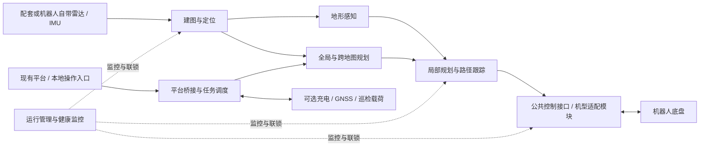

# 导航盒子：现有技术能力与标准产品化评估

评估日期：2026-10-14。评估对象：`task_ws/src`、`nav_t_ws/src`、`drive_ws/src` 中的本地源码、配置、接口、测试文件及维护文档。

## 1. 结论与产品定位

**现有技术已经具备形成导航盒子的软件基础：能够串起传感器接入、建图、重定位、地形感知、导航、机器人控制、任务调度和平台交互。下一阶段的重点是将现有工程能力收敛为稳定、可配置、可验收的交付体系。** 当前适合先推出限定机器人型号、固件、传感器组合和运动学类型的标准版，再推出客户可自行适配的开发版。

建议将产品定义为“机器人自主导航与任务执行控制盒”：盒内提供算法、运行管理和对外接口，机器人本体负责底层运动控制；雷达、IMU、GNSS、巡检载荷可来自机器人或配套套件。防水外壳和 5G 是产品硬件与通信组成部分，不能替代传感器、运动接口或现场标定。

| 交付场景 | 目标体验 | 必须明确的交付边界 |
| --- | --- | --- |
| 已适配机器人标准版 | 选择型号，连接供电/通信/指定传感器，完成首次配置后即可建图与导航 | 支持清单必须包含机器人型号、固件/SDK 版本、传感器型号、安装位置和功能范围；同型号但版本或安装方式不同，需要重新确认兼容性 |
| 未适配机器人开发版 | 客户通过公开基类、参数和示例实现适配，验证通过后复用导航与任务能力 | 客户实现机器人协议转换、状态反馈及必要的传感器接入；盒内提供可选择的运动学模型、适配加载机制和一致性测试，核心算法以二进制交付 |

“开箱即用”应理解为标准组合的安装和首次初始化流程可由客户完成；首次建图、地图导入、传感器外参和安全限速仍有明确操作步骤。对于不能横移或不能原地转向的机器人，需要相应的规划与跟踪模型，不能只把 `/cmd_vel` 转成厂家协议就视为适配完成。

## 2. 参数与成熟度的评估口径

本文的技术参数均注明来源配置或实现；不同机型、启动参数和部署版本可能覆盖这些值。**配置频率不等于板卡实测频率，地图分辨率不等于定位精度，到达容差不等于实测到点误差，速度上限和坡度阈值不等于机器人实际运动能力。** 定位精度、导航成功率、重定位耗时、最大地图规模、板卡资源占用及环境适应性，尚需形成统一实测报告。

成熟度百分比是面向“可作为标准产品交付”的工程判断，以 5% 为粒度，参考功能完整性、接口可复用性、异常处理、验证依据和安装维护能力；不是测试通过率、代码覆盖率或量产认证结果。本次进行了静态核查，没有运行机器人、重跑测试或验证整盒硬件；测试文件存在只能说明具备验证基础。

| 分值区间 | 含义 |
| --- | --- |
| 80%–90% | 主要功能和工程链路较完整，重点补标准交付与系统级验证 |
| 65%–75% | 已有可用工程实现，但跨机型一致性、异常边界或验收数据仍需补齐 |
| 45%–60% | 有关键基础，仍需开发产品级接口与交付闭环 |
| 低于 45% | 当前仓库不足以证明标准交付，需要专项设计、实现或验证 |

## 3. 能力单元分析

### 3.1 传感器接入与点云处理

**能力说明：** `livox_ros_driver2` 提供 Livox 雷达接入，`cloud_merge` 对前后雷达点云按时间匹配、外参变换和体素降采样；SLAM 前处理包含 Livox、Velodyne、Ouster 类型入口及 Airy 点云配置，能够复用机器人已有雷达和 IMU。不同传感器的点字段、逐点时间、加速度单位和坐标约定仍需逐项确认，算法入口存在不代表所有品牌设备已经完成整机适配。

**主要技术参数：** `cloud_merge/config/cloud_merge.yaml`：点云匹配容差 **0.05 s**、队列长度 **3**、体素尺寸 **0.1 m**，支持前后雷达独立 **4×4 外参矩阵**；`faster_slam/config/mid360.yaml`：近距离滤除阈值 **0.1 m**，支持自身包围盒过滤；D1 Max 配置可选择独立 IMU 驱动输入。

**成熟度：80%。** 现有多种传感器处理链和明确配置已具备复用基础，标准化接入与安装自检尚未闭环。

**产品化改进：** 固定首批传感器组合与接线标准；统一时间戳、点云字段、IMU 单位和 TF 约定；提供外参导入/校验、设备发现、数据频率和丢包自检；为机器人自带传感器与盒子配套传感器分别提供配置模板。

### 3.2 三维建图与回环优化

**能力说明：** `faster_slam` 基于 Faster-LIO 的雷达惯性前端，以迭代误差状态卡尔曼滤波和 iVox 地图完成里程计估计，后端利用 ICP 回环约束与 GTSAM/iSAM2 位姿图优化生成先验点云地图。已有在线建图、地图保存以及离线再优化相关实现，可作为产品的地图生产基础。

**主要技术参数：** `mid360.yaml`：前端点云/地图滤波尺寸 **0.4 m**；关键帧间隔 **1.0 m 或 30°**；回环候选半径 **20 m**、最小时间间隔 **60 s**；回环检测配置频率 **5 Hz**、图更新配置频率 **20 Hz**；优化地图输出滤波尺寸 **0.4 m**。这些是采样与计算配置，不能据此推导地图精度或最大建图面积。

**成熟度：80%。** 建图与优化的核心链路较完整，地图质量验收和面向客户的操作流程仍需标准化。

**产品化改进：** 提供统一建图入口、保存进度与完成反馈；增加地图完整性检查、质量报告和大地图资源限制；形成可导入/导出的地图包，将点云、二维地图、拓扑、坐标关系和版本元数据绑定；明确动态环境、长走廊和弱几何场景的使用条件。

### 3.3 初始重定位与持续定位

**能力说明：** `faster_slam` 可加载先验地图，以重力对齐和初始位姿完成 ICP 或 Fusion（NDT 粗匹配＋ICP 细配准）初始化，随后持续进行 Scan-to-Map 定位；已有等待数据、重力对齐、初始配准、跟踪和配准阻塞状态，以及失败回滚、有限重试和外部重启接口。目前初始化依赖配置的初始位置/航向等条件，不能据此承诺任意地点、任意朝向的全局重定位或运行中丢定位后的自动恢复。

**主要技术参数：** `mid360.yaml`：默认方法 **ICP**、接受分数阈值 **0.08**、扫描降采样 **0.3 m**、累计 **1 帧**、自动尝试 **3 次**；ICP 最大匹配距离 **1 m**、最大迭代 **100 次**；Fusion 的 NDT 分辨率 **1 m**、线程数 **6**；初始化状态约 **2 Hz** 发布；`localization.map_update_en=false`，持续定位默认不更新先验地图。配准分数不是厘米误差或统一概率值。

**成熟度：75%。** 初始化状态与失败恢复已有工程封装，运行中定位质量判断和完整恢复策略仍需加强。

**产品化改进：** 将地图选择、初始位置设置和失败重试做成客户可操作流程；持续输出可解释的定位健康状态，联动限速/停车；验证运行中漂移、地图变化、传感器中断和恢复行为；按场景测量冷启动耗时、初始化成功率、位置/航向误差及可接受初始偏差范围。

### 3.4 地形感知与可通行地图

**能力说明：** `gridmapper` 将点云和位姿转为包含高程、坡度、粗糙度、台阶与可通行性的 2.5D 网格，支持全局积累、局部滑动窗口和 OpenCL 加速，并可融合静态地图补充部分盲区信息。该单元将足式机器人的地形导航能力沉淀为公共感知层，但通行阈值必须与机器人实际能力和传感器覆盖范围匹配。

**主要技术参数：** `gridmapper_local.yaml`：局部窗口跨度 **7 m**、栅格分辨率 **0.1 m**、输入高度过滤 **−1.0～0.5 m**、坡度硬阈值 **60°**、台阶阈值 **0.2 m**，默认启动配置启用 GPU；`gridmapper_global.yaml` 的局部处理窗口为 **15 m**。点云失联后的静态地图测试兜底默认关闭，其超时配置 **0.5 s**；此兜底不能提供实时障碍、负障碍及完整地形信息。

**成熟度：75%。** 多层地形分析与加速链路已形成，跨硬件性能和地形边界验证仍需补齐。

**产品化改进：** 按机型约束坡度、台阶和高程过滤参数，避免将算法阈值当作爬坡承诺；验证楼梯、坡道、坑洞、悬空物与低矮障碍；测试目标板卡 OpenCL 驱动兼容性与持续负载；明确点云过期时的停车或降级策略，不能将测试兜底直接用作正式运行保障。

### 3.5 全局规划与跨地图导航

**能力说明：** `multi_map_nav_ros2` 在 Nav2 基础上提供同图和跨图导航，解析地图坐标关系及传送点拓扑，完成目标合法性检查、分段执行和地图切换，并向任务层暴露导航 Action 与健康状态；`smac_straight_planner` 是可选全局规划插件，用于在二维代价地图内优化直线段和转角。跨地图拓扑可表达区域连接，但不等于已经完成电梯控制、门禁联动或任意三维空间导航。

**主要技术参数：** 当前默认 `new_local.yaml` 使用 **SmacPlanner2D**：代价地图分辨率 **0.05 m**、期望规划频率 **2 Hz**、最大规划时间 **5 s**；普通目标容差 **0.1 m / 0.1 rad**，传送点容差 **0.5 m / 2π rad**；普通矩形轮廓示例 **1.0×0.47 m**、轮廓扩展 **0.05 m**。可选直线化插件默认输出间距 **0.05 m**、碰撞采样步长 **0.025 m**、期望转角半径 **0.4 m**，该半径不是车辆最小转弯半径保证。

**成熟度：80%。** 单图、跨图及目标管理链路较完整，多地图数据治理和跨场景验收仍需产品化。

**产品化改进：** 提供地图/连接点编辑与预检工具；统一自动切图和人工切图的失败、回滚、可恢复语义；首版固定默认规划器，可选插件单独验收；按机器人运动学选择规划器，补充差速或阿克曼约束；禁止将传送点类型直接宣传为已实现的楼梯、电梯业务能力。

### 3.6 局部规划、避障与路径跟踪

**能力说明：** `local_planner` 根据全局路线、实时地形和里程计，从预生成运动原语中选择局部路径，由 `pathFollower` 输出限速、限加减速的速度指令；支持绕障或遇障停车策略、终点姿态处理、运动阻塞上报和里程计失效时的零速度保护。当前运动原语与跟踪方式主要服务足式/全向运动场景，实时障碍更新不等同于具备行人轨迹预测能力。

**主要技术参数：** X30/D1M 配置：局部规划 **20 Hz**、路径跟踪 **50 Hz**、局部目标更新 **5 Hz**、里程计接收超时 **0.5 s**；D1M 平地模型速度上限 **1.2 m/s**、横向 **0.4 m/s**、角速度 **0.8 rad/s**，非平地模型为 **2.2 m/s / 0.5 m/s / 1.5 rad/s**；停障安全间距 **0.4 m**、检测距离 **2.5 m**、确认 **0.2 s**、障碍清除确认 **0.5 s**，D1M 停障终止超时 **10 s**。速度模型是配置示例，最终受底盘、制动距离和场地约束。

**成熟度：75%。** 规划、跟踪与部分异常保护已有实现，跨运动学复用和实测避障边界仍是主要缺口。

**产品化改进：** 建立全向、差速、阿克曼能力分类及控制器选择机制；同步车体轮廓、运动原语和传感器安装参数；公开限速、安全距离及避障策略，内部评分参数使用经过验证的预设；验证动态障碍、狭窄通道、倒车、终点对齐和制动距离；增加地形数据过期与速度源冲突的系统级联动保护。

### 3.7 已适配机器人的控制桥接

**能力说明：** `nav_bridge` 已有 X30、D1 Max、Cyvet 三种启动分支，将上层速度和动作转换为厂家 UDP/SDK/DDS 接口，并发布机器人状态、电池、IMU 或里程计等信息；已有控制权接管/释放、起立/运动准备、软急停与部分机型充电接口。三类实现共用部分后端抽象，但 ROS 装配和动作细节仍按机型分别实现，不能默认其功能与反馈语义完全一致。

**主要技术参数：** `x30_params.yaml`、`d1_max_params.yaml`：速度下发配置 **50 Hz**；`cyvet_params.yaml`：**10 Hz**，RPC 超时 **500 ms**；速度输入超时分别为 X30 **5000 ms**、D1 Max **500 ms**、Cyvet **500 ms**；D1 Max 连接超时 **5000 ms**、重连间隔 **2000 ms**。X30 的输入超时后归零速度与释放控制权是不同操作。

**成熟度：75%。** 多机型适配已有真实工程基础，距离严格的型号版本兼容与一致性交付仍有差距。

**产品化改进：** 为每个机型发布功能矩阵、支持固件、动作完成判据和接线套件；统一单位、方向、状态新鲜度、错误码及控制权语义；按制动需求审查不同机型的速度超时，不能直接将现有 **5 s** 当作通用安全值；验证断线、重连和遥控接管时不会残留运动指令；起立、充电等能力必须按型号单独标注。

### 3.8 客户二次开发适配 SDK

**能力说明：** `nav_bridge/include/nav_bridge/robot_backend.hpp` 已定义 `RobotBackend`，涵盖连接、控制权、速度、姿态动作、软急停、模式、状态及回调，可作为客户适配接口的起点；但当前启动文件按机型硬编码分支，后端抽象还未形成完整的独立加载、公共节点封装和客户 SDK 交付链路。现有接口还强制包含 `stand/lie` 等足式动作，需处理轮式机器人不具备这些能力的情况。

**主要技术参数：** 速度接口为 `move(vx, vy, vyaw)`；状态包含连接、控制权、运动状态、速度及电量，另有 IMU、里程计、关节和故障回调。当前支持选择项为 **x30 / d1_max / cyvet**，未知 `robot_type` 在启动时被拒绝；SDK 的 ABI 稳定性、兼容版本和适配性能指标尚未形成产品规范。

**成熟度：50%。** 公开基类的核心雏形已存在，客户仅靠基类和参数完成独立适配的交付闭环仍需开发。

**产品化改进：** 将公共 ROS 节点与厂家协议后端分离，引入插件注册/加载或独立适配进程；设计能力声明，将起立、横移、充电、关节反馈等列为可选能力；统一动作成功/拒绝/超时/完成状态；提供最小示例、模拟机器人、版本规范和适配验收工具；核心导航以二进制发布，客户只需编译适配模块。轮式模型选择和传感器配置也必须纳入 SDK，避免只开放协议桥接却仍需修改内部算法。

### 3.9 点位与跨点位任务调度

**能力说明：** `inspection_task_hub` 以 YAML 路线和状态机组织点位导航、到点动作与跨点位任务，支持启动、查询、暂停、恢复、取消、循环、重试、失败跳过或返回安全点，并对云台、采集、步态、报警、充电等外部能力进行编排。已有并行任务取消协调、运行日志和多类模拟/集成测试，适合作为导航盒子的任务执行中枢。

**主要技术参数：** 航点描述包含 `frame_id`、位姿、到点行为、停留时间和 `max_retry`；任务包含触发时机、`timeout`、失败策略，可用 `start_waypoint_id/end_waypoint_id` 定义跨点任务；`system.yaml`：心跳与机器人状态过期阈值均 **3 s**，通用 Trigger 服务超时 **30 s**，人工模式就绪等待 **60 s**；同一协调器串行处理路线控制，支持路线内并行任务，不能理解为多条独立路线同时执行。

**成熟度：85%。** 任务编排与异常管理覆盖较充分，标准任务协议、配置校验和掉电恢复能力仍需完善。

**产品化改进：** 为任务 YAML 建立版本化 schema、编辑与校验工具，首版只开放已验收任务类型；为导航标准版裁剪巡检专用依赖；审查 `require_waypoint_validation_success=false` 的默认配置并提供严格模式；增加任务持久化、断电后的安全恢复确认和存储清理；明确取消应答、服务超时与物理动作停止之间的关系，持续保留对迟到结果的防护。

### 3.10 平台桥接与远程交互

**能力说明：** `inspection_platform_bridge` 已将现有平台协议映射为 ROS 任务、模式、地图和手动点动接口，并上报设备属性、事件、位置及媒体信息；算法调用可选择 MQTT 或 HTTP，相关引擎具有 SQLite 队列、重试和结果确认机制。现有平台可继续复用，导航盒子需要补的是设备接入、协议版本和弱网行为；算法队列的可靠性不能直接推导为所有平台控制指令均可断网持久化恢复。

**主要技术参数：** MQTT 按设备 SN 组织主题；已有地图操作基于 `tid` 的重复请求处理；`system.yaml` 的 HTTP 算法传输配置为连接超时 **3 s**、请求超时 **90 s**、重试间隔 **1/2/5 s**，MQTT 算法结果收尾等待 **30 s**；机器人步态属性在现有链路中约 **1 s** 上报一次。5G 带宽、端到端延迟与断线恢复时间需按最终通信硬件实测。

**成熟度：80%。** 平台协议和结果传输已有完整基础，多设备交付与弱网运行契约仍需收敛。

**产品化改进：** 固定首版协议版本、设备注册及配置流程，平台凭据通过独立配置注入；建立控制命令权限、有效期、幂等与断线后处理规则；补充 TLS/证书、网络隔离和远程维护设计；以本地执行保持导航闭环，5G 用于任务下发、状态、媒体及维护，并明确远程手动控制的超时策略；逐项验证网络重连，不默认断网后自动续发运动指令。

### 3.11 自动充电与脱桩恢复

**能力说明：** `inspection_charge_executor` 将导航到充电点、底盘充电指令、充电状态监控、退出充电及返航串为独立流程，任务层可发起或协调该流程；D1 Max 后端具有物理充电/脱桩确认相关实现。该能力依赖底盘、充电桩和状态接口，适合作为按机型授权的可选功能，不能作为所有导航盒子的默认能力。

**主要技术参数：** 执行器配置：到桩导航超时 **180 s**、导航重试参数 **3**、重试间隔 **5 s**；充电启动最多尝试 **2 次**；充电指令与脱桩确认超时均 **75 s**，状态过期 **5 s**、监控 **2 Hz**，充满阈值示例 **76%**；D1 Max 后端充电任务确认超时 **60 s**。默认导航启动配置另存在充电退出等待 **30 s**，需核对实际执行链及部署覆盖值。

**成熟度：70%。** 充电业务链和部分物理确认已有实现，跨机型完成语义及上下层超时一致性仍需专项验收。

**产品化改进：** 声明底盘与充电桩支持矩阵；统一停止充电、开始脱桩、脱桩完成和可导航状态；按真实执行链协调 **30/60/75 s** 等不同等待窗口，避免上层提前判超时或启动导航；验证充电失败、状态过期、人工退出、低电量与任务抢占，并明确未完成脱桩时的移动禁止条件。

### 3.12 系统启动、运行管理与故障保护

**能力说明：** `inspection_bringup` 已集中配置模块开关、启动顺序和 systemd 服务；导航 supervisor 支持 `manual/nav/add` 模式、定位初始化就绪门控、扩展模块启停和工作进程退出后的降级处理。已有日志、心跳、里程计超时归零和软件急停等机制，但启动时节点/话题存在检查及进程存活监控，尚不能替代所有模块的持续数据健康监控和整机运动联锁。

**主要技术参数：** 默认模块间启动间隔 **1 s**、一般就绪超时 **10 s**、定位初始化等待配置 **0 s（不设超时）**；supervisor 约 **1 s** 检查一次 worker 进程；服务默认失败重启间隔 **5 s**；导航服务已有 `nice=-10`、CPU/IO 权重 **900**、OOM 分值调整 **−900** 的配置。当前依赖 ROS 2 Jazzy，配置中可选择 RMW，部署样例仍包含特定用户、绝对路径和网络域。

**成熟度：65%。** 工程启动与部分运行故障处理已有框架，标准镜像、持续诊断和运动安全联锁仍需较多产品工作。

**产品化改进：** 制作固定版本系统镜像和统一配置目录，移除对开发工作区路径的交付依赖；将就绪与运行健康分开，持续监控定位质量、雷达/IMU/地形数据、底盘连接与控制权；统一导航、点动、充电等速度来源的仲裁；设计掉电、进程卡死和重启后的安全状态；补充日志限额、健康面板、一键诊断包及可回滚更新。硬件急停与底盘保护链需单独确认，软件急停接口不能作为已具备硬件安全能力的证明。

### 3.13 GNSS/RTK 与地理坐标导航（可选）

**能力说明：** `gnss_driver` 已支持 G60 NMEA、G90/UM982 和 D1M RTK 话题接入，提供标准 GNSS 输出、GPS 与里程计二维刚体标定、LLA/ENU/world 坐标转换、轨迹导出及地理目标到 Nav2 的桥接，并包含 NTRIP 差分注入。该能力可用于室外位置呈现和地理任务，但不能仅凭 RTK 驱动存在就承诺整套导航达到厘米级精度。

**主要技术参数：** G60/G90 串口配置示例为 **9600 / 460800 baud**；G90/D1M 标定配置：**200 对样本**、最大时间差 **0.15 s**、最小采样位移参数 **1 m**、Huber 加权迭代 **15 次**；地理目标入口为 `inspection_interfaces/action/SetGPSGoal`。实际 GNSS 精度受设备、差分、卫星环境和标定质量影响。

**成熟度：70%。** 多设备接入与坐标转换已形成，质量门控和导航融合边界仍需明确。

**产品化改进：** 固定支持接收机和天线方案；输出 RTK FIX/FLOAT、协方差、差分状态及标定质量；验证室内外过渡、遮挡与失锁；明确 GNSS 是位置展示、目标转换还是定位辅助，分别验收，避免将其统一描述为已完成的无缝融合定位。

### 3.14 巡检载荷、采集与报警（可选）

**能力说明：** `sensor_gimbal`、`gas_monitor`、`sensor_rs485`、`acoustic_monitor`、`alarm_manager` 和 `light_manager` 已提供云台/媒体、热成像与烟火、气体/环境、声学和报警输出等能力，并可与点位或跨点位任务关联。现有能力适合形成导航盒子的巡检扩展包，使基础导航交付不必绑定所有厂家设备和业务算法。

**主要技术参数：** 默认气体采集为 **9600 baud / 1000 ms 轮询**，RS485 环境采集为 **19200 baud / 1000 ms 轮询**；声学配置原始帧、可见光图和热力图发布间隔 **100 ms**、状态 **1000 ms**；热成像实时轮询 **1000 ms**。这些是接口采集/发布配置，测量精度、识别率和视频性能需引用相应设备及整机测试。

**成熟度：70%。** 业务功能与任务集成较丰富，载荷标准接口和跨厂家验收仍以项目配置为主。

**产品化改进：** 提供载荷能力注册、设备模板和统一结果格式；分离必选与可选进程；明确 ARM64/x86_64 SDK、授权和模型依赖；分别验收云台角度、采集时延、检测效果及报警联动，不把某个设备的能力自动推广到所有载荷。

### 3.15 板卡、外壳与 5G 整盒交付

**能力说明：** 软件栈已有板端部署背景，Cyvet 维护文档记录 ARM64/x86_64 环境与 RK3588 部署，地形计算依赖目标平台 OpenCL，部分载荷依赖厂家二进制库；但本次仓库范围没有形成可核实的导航盒子硬件规格、供电设计、防水验证、5G 管理或环境测试报告。整盒产品需要在选定板卡上验证全链路，不能直接将开发板可运行等同于封装后的长期可运行。

**主要技术参数：** 当前可核实的软件环境基线为 **Ubuntu 24.04 / ROS 2 Jazzy**，包含 ARM64/x86_64 部署材料；**板卡型号、CPU/内存/存储、供电范围、功耗、工作温度、防护等级、5G 制式/吞吐、外形重量均待定或待验证**。这些参数应在硬件设计后进入正式规格书。

**成熟度：20%。** 有板端软件运行基础，整盒硬件与通信的标准交付证据仍不足，此分数不评价仓库外尚未提供的硬件成果。

**产品化改进：** 明确盒内传感器及盒外接口边界，完成供电保护、密封连接器、散热和天线布局；测试防水结构下满负载温升、5G 发射与电源波动；验证振动、EMC、掉电和长期运行；开发 5G 入网、重拨、链路诊断与远程维护；建立出厂烧录、序列号、校准、恢复和硬件版本追溯流程。防护等级可作为设计目标，须经测试后才写入交付承诺。

## 4. 面向标准产品的整体判断

软件能力中，任务与平台交互、全局导航和建图的完成度相对较高；机器人控制、定位、局部规划和地形处理已有可复用工程能力。影响产品交付的主要因素是配置与接口跨机型一致性、客户适配边界、持续故障保护、统一验收数据和整盒硬件验证。

| 评估对象 | 综合成熟度判断 | 判断理由 |
| --- | --- | --- |
| 现有软件栈形成统一标准交付 | **约 65%** | 功能链完整，仍以多个工作区、样例配置和逐机型部署为主要交付方式 |
| 已适配机型的标准版交付 | **约 70%** | 有既有机器人后端和启动链，仍需兼容清单、预配置镜像、安装自检与整机验收 |
| 未适配机型的客户开发版交付 | **约 50%** | 基类存在，插件交付、能力声明、运动学选择、文档与一致性验证尚未闭环 |
| 防水＋5G 整盒量产交付 | **暂不评定综合百分比** | 板卡和硬件条件未冻结，缺少整盒测试依据，不能用软件成熟度代替硬件结论 |

上述综合分值是交付路径判断，不是各单元百分比的算术平均。成熟度应在机型、传感器与目标场景冻结后，依据实际验收结果更新。

### 4.1 建议的产品组成与接口边界

建议基础版包含建图、定位、地形感知、导航、机器人桥接、基础任务、平台接入和运行管理；GNSS、自动充电及巡检载荷作为独立功能包。标准版与开发版共用核心算法和任务接口，差异放在机器人适配的交付方式上。

| 接口层 | 向客户开放的内容 | 产品内部负责的内容 |
| --- | --- | --- |
| 机器人适配 | 稳定基类/协议、状态与故障回调、能力声明、适配示例及测试工具 | 公共 ROS 装配、速度仲裁、控制权和超时管理、适配加载 |
| 参数配置 | 机型、尺寸/轮廓、运动学、限速、传感器外参、通行限制、任务与网络配置 | 参数范围检查、关联参数生成、经过验证的算法预设 |
| 地图与任务 | 地图包、路线/任务 schema、状态与结果接口 | 建图与定位算法、地图一致性管理、规划和任务状态机 |
| 扩展载荷 | 标准动作/结果协议、设备适配配置 | 调度、日志、健康管理与平台数据映射 |

客户适配成功的最小条件应包括：可确认的连接与控制权、符合所选运动学模型的速度执行、实时底盘状态/故障反馈，以及满足建图定位输入契约的雷达/IMU。底盘里程计可按方案选择；盒子导航位姿由自身定位链提供。机器人不支持的起立、横移、充电等功能应被能力声明明确禁用，不能以伪成功替代。

### 4.2 分阶段推进建议

| 优先级 | 建议开发内容 | 阶段完成标准 |
| --- | --- | --- |
| P0：冻结首版交付范围 | 选定板卡、首批机器人/固件/传感器；确定基础版功能、运动学类型与场景；统一地图包和单一机型配置入口 | 能给出清晰 BOM、支持矩阵、配置清单与首版产品规格；客户无需编辑多个工作区文件 |
| P0：补齐运行保护 | 统一速度来源、传感器时效、定位质量、控制权、充电/脱桩联锁及超时配置；定义断线与重启状态 | 数据失效、节点卡死、模式切换或充电异常时不会继续执行旧运动指令，错误可定位并可安全恢复 |
| P1：交付已适配标准版 | 固定镜像、预置机型配置、接线套件、安装向导、建图/导图/重定位流程、诊断与日志管理 | 在新的同型机器人上，由非核心研发人员按文档独立完成安装并通过验收 |
| P1：交付开发版 SDK | 发布稳定后端接口、可选能力、插件/进程加载、运动学预设、模拟器和一致性测试 | 外部开发者无需修改盒内核心源码，即可完成一个新机型适配并通过同一套验收 |
| P1：整盒硬件验证 | 封装、防水、供电、散热、5G 与环境测试；复核最终板卡持续计算性能 | 在最终外壳和通信配置下完成满负载与环境测试，形成出厂测试规程 |
| P2：扩展与运维 | GNSS、充电和巡检功能包；签名更新与回滚、设备批量管理、版本追溯 | 扩展包独立验收，更新失败可回退，故障诊断和版本兼容可追溯 |

不建议在首版同时承诺所有足式、轮足、差速和阿克曼底盘。优先以已经适配且反馈充分的机型形成可复制交付，再把第二种运动学类型作为 SDK 能力验证案例；阿克曼车型应作为独立规划/跟踪适配范围评估。

### 4.3 建立正式规格前需要补齐的验收数据

| 维度 | 建议记录的指标 | 验收场景 |
| --- | --- | --- |
| 建图与定位 | 重复建图一致性、位置/航向误差分布、重定位成功率与 P95 耗时、运行漂移 | 室内/室外、长走廊、重复结构、地图变化、不同初始偏差 |
| 导航与避障 | 到点成功率、到点位置/朝向误差、路径跟踪误差、最小通行宽度、停车距离及恢复时延 | 不同速度、载荷、地面、坡道、狭窄区域和移动障碍 |
| 算力与地图规模 | CPU/GPU/内存峰值、持续温度、实际数据/控制频率、规划耗时 P95、可承载地图规模 | 最终板卡与外壳中，导航、5G 和选定载荷并发运行 |
| 异常与连续运行 | 雷达/IMU/底盘/网络中断响应、模式切换、进程退出与卡死、磁盘满、掉电恢复 | 故障注入与建议至少 72 h 连续运行；72 h 为建议首轮测试时长，非现有测试结果 |
| 客户安装与开发 | 首次安装步骤/耗时、配置错误检出率、新机型适配步骤、接口一致性结果 | 新机器的独立安装，以及客户侧模拟后端和实机适配 |
| 硬件与通信 | 供电/功耗、温升、振动、防护等级、5G 重连时间及业务吞吐 | 量产结构、线缆、天线和目标环境下的专项测试 |

具体合格阈值应在目标机型、传感器、板卡与场景冻结后制定。推荐对外承诺“经验证的组合与指标”，内部保留可调参数和扩展能力，避免使用配置值直接填写宣传规格。

## 5. 主要依据与追溯位置

以下路径均为本次核查的本地文件；README 用于说明设计意图，参数以实际配置为依据，部署时还需核对 launch 和运行参数覆盖。

| 能力 | 主要依据 |
| --- | --- |
| 建图、重定位、状态与回环参数 | [faster_slam README](/home/jazzy/nav_t_ws/src/faster_slam/README.md)、[MID360 配置](/home/jazzy/nav_t_ws/src/faster_slam/config/mid360.yaml)、[定位实现](/home/jazzy/nav_t_ws/src/faster_slam/src/laser_mapping.cc) |
| 地形与地图 | [gridmapper README](/home/jazzy/nav_t_ws/src/gridmapper/README.md)、[局部配置](/home/jazzy/nav_t_ws/src/gridmapper/config/gridmapper_local.yaml)、[全局配置](/home/jazzy/nav_t_ws/src/gridmapper/config/gridmapper_global.yaml) |
| 全局与跨图导航 | [multi_map_nav README](/home/jazzy/nav_t_ws/src/multi_map_nav_ros2/README.md)、[默认 Nav2 参数](/home/jazzy/nav_t_ws/src/multi_map_nav_ros2/params/new_local.yaml)、[直线化插件说明](/home/jazzy/nav_t_ws/src/smac_straight_planner/README.md) |
| 局部规划与跟踪 | [local_planner README](/home/jazzy/nav_t_ws/src/local_planner/README.md)、[X30 配置](/home/jazzy/nav_t_ws/src/local_planner/config/x30.yaml)、[D1M 配置](/home/jazzy/nav_t_ws/src/local_planner/config/d1m.yaml)、[局部规划测试目录](/home/jazzy/nav_t_ws/src/local_planner/test) |
| 机器人桥接与 SDK 基础 | [通用后端接口](/home/jazzy/drive_ws/src/nav_bridge/include/nav_bridge/robot_backend.hpp)、[启动选择逻辑](/home/jazzy/drive_ws/src/nav_bridge/launch/nav_bridge.launch.py)、[桥接配置目录](/home/jazzy/drive_ws/src/nav_bridge/config)、[Cyvet 维护说明](/home/jazzy/drive_ws/src/nav_bridge/CYVET.md) |
| 点云与 GNSS | [点云合并配置](/home/jazzy/drive_ws/src/cloud_merge/config/cloud_merge.yaml)、[GNSS README](/home/jazzy/drive_ws/src/gnss_driver/README.md)、[G90 标定配置](/home/jazzy/drive_ws/src/gnss_driver/config/g90_alignment.yaml) |
| 调度与充电 | [任务 README](/home/jazzy/task_ws/src/inspection_task_hub/README.md)、[任务测试目录](/home/jazzy/task_ws/src/inspection_task_hub/test)、[充电执行器配置](/home/jazzy/task_ws/src/inspection_charge_executor/config/inspection_charge_executor_params.yaml) |
| 平台与运维 | [平台桥接 README](/home/jazzy/task_ws/src/inspection_platform_bridge/README.md)、[系统配置](/home/jazzy/task_ws/src/inspection_bringup/config/system.yaml)、[导航启动配置](/home/jazzy/task_ws/src/inspection_bringup/config/navigate.yaml)、[服务配置](/home/jazzy/task_ws/src/inspection_bringup/config/services.yaml)、[supervisor 实现](/home/jazzy/task_ws/src/inspection_bringup/scripts/navigation_supervisor.py) |
| 载荷参数 | [声学配置](/home/jazzy/task_ws/src/acoustic_monitor/config/acoustic_params.yaml)、[气体配置](/home/jazzy/task_ws/src/gas_monitor/config/gas_params_default.yaml)、[环境配置](/home/jazzy/task_ws/src/sensor_rs485/config/sensor_rs485_params.yaml)、[相机配置](/home/jazzy/task_ws/src/sensor_gimbal/config/camera_params.yaml) |
